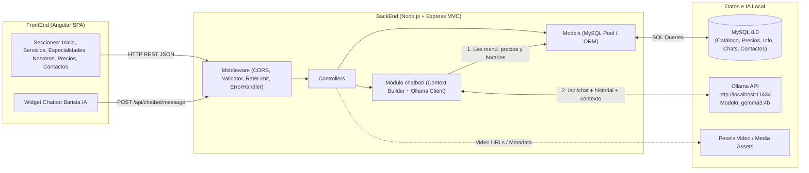
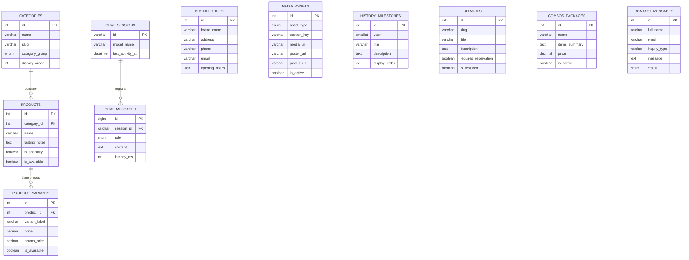
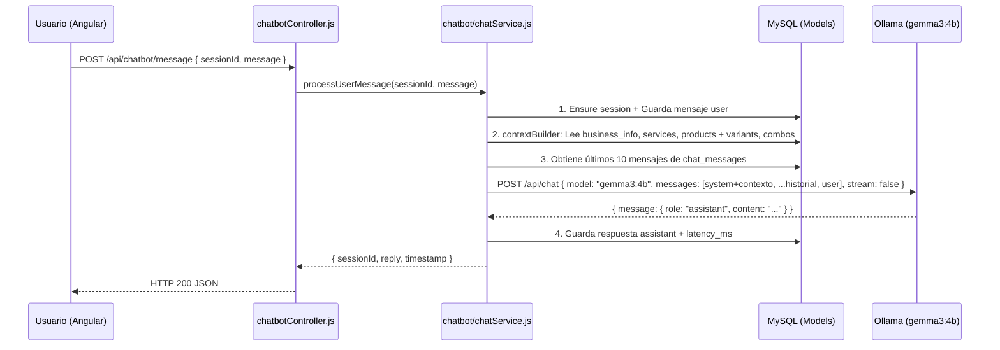

# Especificación Técnica y de Diseño — Web App Cafetería de Especialidad + Chatbot IA

> **Objetivo del documento:** Definir con precisión la arquitectura, el sistema de diseño UI/UX, el esquema de base de datos MySQL, la estructura del backend en Node.js (adaptando la arquitectura del *chatbot del chaco*), la integración con **Ollama + Gemma 3**, los recursos de video desde **Pexels** y las vistas del frontend en **Angular**, garantizando que **el 100% de los datos del frontend se obtengan dinámicamente mediante APIs desde Node.js**.

---

## 1. Resumen Ejecutivo y Stack Tecnológico

| Capa | Tecnología Recomendada | Propósito Principal |
| :--- | :--- | :--- |
| **FrontEnd** | **Angular (v19/v20+, Standalone + Signals)** | SPA reactiva, tipada y modular. Consume exclusivamente la API REST de Node.js. |
| **Estilos / UI** | **SCSS + CSS Custom Properties (o Tailwind CSS)** | Sistema de diseño cálido artesanal (*Warm Minimalism*), responsive y accesible. |
| **BackEnd** | **Node.js + Express (Arquitectura MVC)** | API REST unificada, lógica de negocio, proxy/caché de medios y orquestación del chatbot. |
| **Base de Datos** | **MySQL 8.0+ (`mysql2/promise` o Sequelize)** | Única fuente de verdad para textos, catálogo, precios, servicios, galería, contactos y chats. |
| **IA Local (Chatbot)** | **Ollama + Gemma 3 (`gemma3:4b` / `gemma3:1b`)** | Asistente virtual barista con contexto en vivo consultado desde MySQL. |
| **Multimedia (Videos)** | **Pexels (`https://www.pexels.com/`)** | Videos en bucle para el hero de Inicio (descargados/optimizados o vía Pexels Video API). |

---

## 2. Investigación y Propuesta de Diseño UI/UX

### 2.1 Dirección Estética: *Warm Minimalism & Editorial Craft*
Las cafeterías de especialidad actuales se alejan de las plantillas oscuras genéricas o corporativas frías. El diseño recomendado combina **minimalismo cálido**, **tipografía editorial expresiva** y **storytelling sensorial** (del grano a la taza), transmitiendo la textura física de la madera, el papel artesanal, la cerámica y la crema del espresso.

### 2.2 Sistema de Color (Design Tokens)
Definir estos tokens en `src/styles/_tokens.scss` en Angular para mantener consistencia total:

| Token CSS | Hex | Uso Recomendado |
| :--- | :--- | :--- |
| `--bg-parchment` | `#F7F4EF` | Fondo principal de la aplicación (evita el blanco puro `#FFFFFF` que resulta frío). |
| `--bg-linen` | `#EFE9DF` | Fondo de tarjetas, secciones alternas y contenedores de precios. |
| `--text-espresso` | `#1E1714` | Títulos principales, navegación y textos de alto contraste. |
| `--text-walnut` | `#5C4B43` | Párrafos descriptivos, notas secundarias, subtítulos. |
| `--accent-terracotta` | `#C66B3D` | Botones primarios (CTA), enlaces activos, badges de "Especialidad". |
| `--accent-sage` | `#4A5D4E` | Etiquetas orgánicas/veganas, estado "Disponible", detalles botánicos. |
| `--accent-crema` | `#D4A373` | Bordes suaves, estados hover, separadores de precios. |
| `--overlay-roast` | `rgba(20, 16, 14, 0.56)` | Capa oscura degradada sobre el video de Pexels para garantizar contraste WCAG AA. |

### 2.3 Tipografía
* **Display / Títulos (`--font-display`):** *Fraunces* o *Playfair Display* (serif con personalidad editorial para titulares de Hero, Especialidades y secciones).
* **Cuerpo / UI (`--font-sans`):** *Plus Jakarta Sans* o *Inter* (máxima legibilidad en menús, descripciones y formularios en pantallas móviles).
* **Detalles Técnicos y Precios (`--font-mono`):** *JetBrains Mono* o *Space Mono* (para notas de cata, origen, gramos, horarios y cifras tabulares alineadas en la carta de precios).

### 2.4 Estructura Visual y Layout por Sección
1. **Header Sticky Transparente -> Sólido:** Logo a la izquierda, enlaces limpios (`Inicio`, `Servicios`, `Especialidades`, `Nosotros`, `Precios`, `Contactos`) y botón sutil para abrir el **Barista IA** (`Gemma 3`). Al hacer scroll, pasa de transparente (sobre el video) a `--bg-parchment` con blur suave (`backdrop-filter: blur(10px)`).
2. **Hero Full-Viewport (Inicio):** Video de cafetería en bucle (100vh desktop / 85vh móvil) + overlay degradado + título editorial + 2 CTAs (`Explorar Precios` y `Hablar con el Barista IA`). Debajo, franja de métricas/horarios en vivo y accesos rápidos a servicios y especialidades destacadas.
3. **Grid de Servicios:** Tarjetas con bordes sutiles (`1px solid rgba(30, 23, 20, 0.08)`), íconos lineales, título, descripción y etiqueta de disponibilidad (ej. *Requiere reserva* / *Todos los días*).
4. **Bento Grid de Especialidades:** Cuadrícula asimétrica (tarjetas grandes para bebidas de autor/granos estrella y medianas para pastelería), mostrando fotografía, notas de cata, nivel de tueste y chips dietéticos (`Vegano`, `Sin TACC`, `Origen Único`).
5. **Sección Nosotros (Storytelling + Tienda):**
   * Bloque superior *Split 50/50*: Historia de la cafetería + línea de tiempo vertical con hitos desde MySQL.
   * Bloque medio: **Galería de fotos de la tienda** (salón, barra, fachada, tostado) con vista ampliada (lightbox).
   * Bloque inferior: Ficha práctica (dirección exacta, teléfono/WhatsApp, horarios por día y mapa interactivo).
6. **Carta de Precios Interactiva:** Tabs por categoría (`Espresso Bar`, `Filtrados`, `Bebidas Frías`, `Pastelería`, `Granos para llevar`, `Combos`), selector de tamaño/variante (`Chico`, `Mediano`, `Grande`, `250g`, `500g`) con actualización instantánea de precio mediante Signals y buscador rápido.
7. **Contactos (Split Layout):** Columna izquierda con canales directos extraídos de la API (teléfono, dirección, horarios, redes) y columna derecha con formulario reactivo validado y feedback visual de envío exitoso.
8. **Chatbot Barista IA (Widget Flotante Global):** Botón circular en la esquina inferior derecha (`bottom: 24px; right: 24px`) que abre un panel lateral/popover estilo editorial (burbujas diferenciadas, indicador de escritura *"El barista está pensando..."*, chips de preguntas sugeridas).

### 2.5 Accesibilidad y Responsive
* Contraste mínimo **4.5:1** en todo texto sobre video o imagen mediante `linear-gradient(to top, rgba(20,16,14,0.75), rgba(20,16,14,0.35))`.
* Respetar `@media (prefers-reduced-motion: reduce)`: si está activo, mostrar la imagen `poster` estática en lugar de reproducir el video en bucle.
* Diseño *Mobile-First*: barra de navegación inferior o menú drawer táctil; tablas de precios convertidas a tarjetas apiladas en `< 768px`.

---

## 3. Estrategia de Videos con Pexels (`https://www.pexels.com/`)

El video de la sección **Inicio** debe transmitir atmósfera de cafetería sin penalizar el tiempo de carga (*LCP*).

### 3.1 Qué buscar en Pexels
Clips en **orientación horizontal (`landscape`)**, iluminación cálida y movimiento lento/estable de **5 a 12 segundos**:
* Extracción de espresso en primer plano: [`https://www.pexels.com/search/videos/pouring%20coffee/`](https://www.pexels.com/search/videos/pouring%20coffee/)
* Ambiente de cafetería y barista preparando bebidas: [`https://www.pexels.com/search/videos/coffee%20shop%20barista/`](https://www.pexels.com/search/videos/coffee%20shop%20barista/)
* Arte latte en taza de cerámica: [`https://www.pexels.com/search/videos/latte%20art%20coffee%20shop/`](https://www.pexels.com/search/videos/latte%20art%20coffee%20shop/)
* Tostado y caída de granos de café: [`https://www.pexels.com/search/videos/coffee%20beans%20roasting/`](https://www.pexels.com/search/videos/coffee%20beans%20roasting/)

### 3.2 Dos Modos de Integración (siempre servidos vía API Node.js)

| Estrategia | Cómo Funciona | Ventajas | Recomendación |
| :--- | :--- | :--- | :--- |
| **Opción A: Curado Local + Metadata en MySQL** | Descargas el clip elegido desde `pexels.com`, lo optimizas con `ffmpeg` (720p/1080p, sin audio, < 3 MB) en `/backend/public/videos/`, y guardas su URL + `pexels_source_url` + autor + `poster_url` en la tabla `media_assets`. | Carga instantánea, no depende de límites externos ni expiración de enlaces CDN, bucle suave garantizado. | **Recomendada para producción y entregas académicas/demo.** |
| **Opción B: Pexels Videos API desde Node.js** | El backend llama a `GET https://api.pexels.com/v1/videos/search?query=coffee+shop&orientation=landscape&size=medium` con `Authorization: PEXELS_API_KEY` (en `.env`), cachea el MP4 HD (`video_files`) y el `image` (poster) en MySQL y lo entrega al frontend. | Permite cambiar o rotar videos dinámicamente sin redeployar archivos. | Útil si quieres un selector dinámico o panel admin futuro. |

> **Importante:** Nunca colocar la `PEXELS_API_KEY` en Angular; toda consulta a Pexels o lectura de `media_assets` pasa por Node.js (`GET /api/home` o `GET /api/media/hero`).

### 3.3 Optimización Técnica del Video Loop (`ffmpeg` + Angular)
Si usas la Opción A, optimiza el `.mp4` descargado de Pexels eliminando la pista de audio y comprimiendo para web:
```bash
ffmpeg -i pexels-cafe-original.mp4 -an -vcodec libx264 -crf 28 -preset slow -vf "scale=1280:-2" -movflags +faststart hero-cafe-loop.mp4
```
Y en el componente Angular (`HeroVideoComponent`):
* Atributos obligatorios: `autoplay`, `muted`, `loop`, `playsinline`, `preload="auto"`, `[poster]="heroMedia()?.posterUrl"`.
* Refuerzo programático en `afterNextRender` / `ngAfterViewInit`: asignar `video.muted = true` y ejecutar `video.play().catch(...)` para evitar bloqueos de políticas de autoplay en Safari/Chrome.

---

## 4. Arquitectura del FrontEnd en Angular

### 4.1 Principios Técnicos
* **100% Standalone Components** (sin `NgModules`).
* **Reactividad con Signals:** `signal()`, `computed()`, `effect()`, y `toSignal()` para enlazar respuestas HTTP de RxJS.
* **Inyección funcional:** `inject(HttpClient)`, `inject(ActivatedRoute)`, `inject(FormBuilder)`.
* **Control Flow nativo:** `@if`, `@for` (con `track item.id`), `@defer (on viewport)` para galería y mapa.
* **Cero datos hardcodeados:** Todo el contenido visible se obtiene de `environment.apiUrl` (`http://localhost:3000/api`) con estados de carga (*skeletons*) y manejo de errores.

### 4.2 Estructura de Carpetas Sugerida (`frontend/`)
```text
frontend/
├── src/
│   ├── environments/
│   │   ├── environment.ts            # apiUrl: 'http://localhost:3000/api'
│   │   └── environment.prod.ts
│   ├── styles/
│   │   ├── _tokens.scss              # Paleta, tipografías, radios, sombras
│   │   └── _mixins.scss
│   └── app/
│       ├── core/
│       │   ├── interceptors/
│       │   │   └── api-error.interceptor.ts
│       │   ├── models/               # Interfaces TypeScript (Service, Product, PriceVariant, About, ChatMessage...)
│       │   └── services/             # Comunicación HTTP con Node.js
│       │       ├── home-api.service.ts
│       │       ├── catalog-api.service.ts
│       │       ├── about-api.service.ts
│       │       ├── contact-api.service.ts
│       │       └── chatbot-api.service.ts
│       ├── shared/
│       │   └── components/
│       │       ├── navbar/
│       │       ├── footer/
│       │       ├── chatbot-widget/   # Widget flotante global conectado a Ollama/Gemma 3
│       │       ├── skeleton-card/
│       │       └── price-badge/
│       ├── features/
│       │   ├── inicio/               # Hero con video Pexels + resumen dinámico
│       │   ├── servicios/            # Listado de servicios de la cafetería
│       │   ├── especialidades/       # Productos insignia + notas de cata + filtros
│       │   ├── nosotros/             # Historia, dirección, teléfono, horarios, galería tienda
│       │   ├── precios/              # Carta interactiva por categorías, tamaños y combos
│       │   └── contactos/            # Formulario reactivo + canales directos
│       ├── app.component.ts          # Layout raíz (Navbar + RouterOutlet + Footer + ChatbotWidget)
│       ├── app.config.ts             # provideRouter, provideHttpClient(withInterceptors(...))
│       └── app.routes.ts             # Rutas con lazy loading (loadComponent)
```

### 4.3 Especificación Funcional de cada Sección

| Ruta Angular | Contenido y Componentes | Endpoint(s) Consumidos |
| :--- | :--- | :--- |
| **`/inicio`** | Video loop Pexels (`<video>` con poster y overlay), propuesta de valor, 3 servicios destacados, 4 especialidades estrella, bloque rápido de horarios y CTA al chatbot. | `GET /api/home` |
| **`/servicios`** | Cards detalladas de cada servicio (barra de especialidad, métodos filtrados, coworking/Wi-Fi, catas y talleres, take away, catering para eventos), indicador de reserva y horario. | `GET /api/services` |
| **`/especialidades`** | Bento Grid con bebidas de autor, cafés de origen único y pastelería artesanal; filtros por etiqueta (`Vegano`, `Sin Gluten`, `Frío`, `Caliente`) y detalle de notas de cata/tueste. | `GET /api/specialties` |
| **`/nosotros`** | Datos institucionales (nombre, dirección, teléfono, WhatsApp, email, horarios), línea de tiempo histórica (`history_milestones`), mapa embebido y galería de fotos de la tienda (`store_gallery`) con lightbox. | `GET /api/about` |
| **`/precios`** | Pestañas por categoría, barra de búsqueda, selector de variantes/tamaños (ej. Chico/Mediano/Grande o 250g/500g) con precios desde MySQL, y sección de combos/paquetes promocionales. | `GET /api/prices` |
| **`/contactos`** | Ficha de contacto directa + mapa + Formulario reactivo (`nombre`, `email`, `teléfono`, `tipo de consulta`, `mensaje`) con validación en tiempo real y confirmación persistida. | `GET /api/about` (info), `POST /api/contact` |
| **Global (`ChatbotWidget`)** | Ventana de chat flotante persistente; guarda `sessionId` en `sessionStorage`; muestra historial de la sesión, chips de preguntas rápidas y respuestas generadas por Gemma 3 en Ollama. | `POST /api/chatbot/message`, `GET /api/chatbot/history/:sessionId` |

---

## 5. Arquitectura Global y Flujo de Datos



---

## 6. Base de Datos MySQL: Tablas Necesarias, Relaciones y DDL

### 6.1 Trazabilidad: Qué Tabla Alimenta Qué Parte del FrontEnd

| Tabla MySQL | Propósito | Secciones del FrontEnd que la consumen |
| :--- | :--- | :--- |
| `business_info` | Datos maestros del local (nombre, eslogan, historia intro, dirección, teléfono, whatsapp, email, horarios, coordenadas, redes). | **Inicio**, **Nosotros**, **Contactos**, **Footer**, **Chatbot** |
| `media_assets` | Videos en bucle de Pexels (`video_hero`) y fotos de la tienda (`gallery_store`), con URLs, poster y créditos de Pexels. | **Inicio** (video loop), **Nosotros** (fotos de la tienda) |
| `history_milestones` | Hitos cronológicos de la historia de la cafetería (año, título, relato, orden). | **Nosotros** (historia) |
| `services` | Servicios que ofrece la cafetería (Wi-Fi/coworking, catering, talleres, take away, etc.). | **Servicios**, **Inicio** (destacados), **Chatbot** |
| `categories` | Categorías ordenadas para menú y especialidades (Espresso, Filtrados, Pastelería, Granos). | **Especialidades**, **Precios**, **Chatbot** |
| `products` | Productos y especialidades (descripción, notas de cata, origen, tueste, imagen, `is_specialty`, etiquetas dietéticas). | **Especialidades**, **Precios**, **Inicio**, **Chatbot** |
| `product_variants` | Tamaños/gramajes y precios exactos de cada producto (ej. 8oz, 12oz, 250g). | **Precios**, **Especialidades**, **Chatbot** |
| `combos_packages` | Combos de desayuno/merienda o paquetes de catering con precio cerrado. | **Precios**, **Chatbot** |
| `contact_messages` | Mensajes enviados desde el formulario de contacto (`POST /api/contact`). | **Contactos** |
| `chat_sessions` | Sesiones anónimas o identificadas del widget de chatbot. | **Chatbot** |
| `chat_messages` | Historial de mensajes (`user` / `assistant`) y métricas de respuesta de Gemma 3. | **Chatbot** |

### 6.2 Diagrama Entidad-Relación (MySQL)



### 6.3 Script SQL Completo (MySQL 8.0+)

```sql
CREATE DATABASE IF NOT EXISTS cafeteria_db
  CHARACTER SET utf8mb4
  COLLATE utf8mb4_unicode_ci;

USE cafeteria_db;

-- 1. Información institucional de la cafetería (Nosotros, Contactos, Footer, Chatbot)
CREATE TABLE business_info (
  id INT AUTO_INCREMENT PRIMARY KEY,
  brand_name VARCHAR(120) NOT NULL,
  slogan VARCHAR(200) NULL,
  short_about TEXT NOT NULL,
  full_history TEXT NOT NULL,
  address VARCHAR(255) NOT NULL,
  city VARCHAR(100) NOT NULL,
  phone VARCHAR(40) NOT NULL,
  whatsapp VARCHAR(40) NULL,
  email VARCHAR(120) NOT NULL,
  latitude DECIMAL(10, 7) NULL,
  longitude DECIMAL(10, 7) NULL,
  opening_hours JSON NOT NULL COMMENT 'Ej: {"lunes_viernes":"07:30 - 20:30","sabado":"08:30 - 21:00","domingo":"09:00 - 19:00"}',
  social_links JSON NULL COMMENT 'Ej: {"instagram":"https://...","tiktok":"https://..."}',
  updated_at TIMESTAMP DEFAULT CURRENT_TIMESTAMP ON UPDATE CURRENT_TIMESTAMP
);

-- 2. Videos (Pexels) y fotos de la tienda (Inicio Hero + Nosotros Galería)
CREATE TABLE media_assets (
  id INT AUTO_INCREMENT PRIMARY KEY,
  asset_type ENUM('video_hero', 'gallery_store', 'section_banner') NOT NULL,
  section_key ENUM('inicio', 'nosotros', 'servicios', 'especialidades', 'precios') NOT NULL,
  title VARCHAR(150) NOT NULL,
  caption VARCHAR(255) NULL,
  media_url VARCHAR(500) NOT NULL COMMENT 'URL MP4 servida por Node.js o CDN Pexels',
  poster_url VARCHAR(500) NULL COMMENT 'Imagen previa para carga rápida del video',
  pexels_id VARCHAR(60) NULL,
  pexels_url VARCHAR(500) NULL,
  pexels_author VARCHAR(120) NULL,
  display_order INT NOT NULL DEFAULT 0,
  is_active TINYINT(1) NOT NULL DEFAULT 1,
  created_at TIMESTAMP DEFAULT CURRENT_TIMESTAMP,
  INDEX idx_media_section_active (section_key, asset_type, is_active, display_order)
);

-- 3. Hitos históricos (Nosotros)
CREATE TABLE history_milestones (
  id INT AUTO_INCREMENT PRIMARY KEY,
  milestone_year SMALLINT NOT NULL,
  title VARCHAR(150) NOT NULL,
  description TEXT NOT NULL,
  image_url VARCHAR(500) NULL,
  display_order INT NOT NULL DEFAULT 0,
  is_active TINYINT(1) NOT NULL DEFAULT 1
);

-- 4. Servicios ofrecidos por la cafetería (Servicios + Inicio + Chatbot)
CREATE TABLE services (
  id INT AUTO_INCREMENT PRIMARY KEY,
  slug VARCHAR(100) NOT NULL UNIQUE,
  title VARCHAR(140) NOT NULL,
  short_description VARCHAR(255) NOT NULL,
  full_description TEXT NOT NULL,
  icon_name VARCHAR(80) NOT NULL COMMENT 'Nombre de ícono para Angular (Lucide/Material)',
  image_url VARCHAR(500) NULL,
  availability_note VARCHAR(150) NULL COMMENT 'Ej: Lunes a Domingo / Previa reserva',
  starting_price DECIMAL(10, 2) NULL,
  requires_reservation TINYINT(1) NOT NULL DEFAULT 0,
  is_featured TINYINT(1) NOT NULL DEFAULT 0,
  display_order INT NOT NULL DEFAULT 0,
  is_active TINYINT(1) NOT NULL DEFAULT 1,
  INDEX idx_services_active (is_active, is_featured, display_order)
);

-- 5. Categorías de carta (Especialidades + Precios)
CREATE TABLE categories (
  id INT AUTO_INCREMENT PRIMARY KEY,
  name VARCHAR(100) NOT NULL,
  slug VARCHAR(100) NOT NULL UNIQUE,
  description VARCHAR(255) NULL,
  category_group ENUM('bebidas_calientes', 'bebidas_frias', 'pasteleria', 'granos', 'salados') NOT NULL,
  display_order INT NOT NULL DEFAULT 0,
  is_active TINYINT(1) NOT NULL DEFAULT 1
);

-- 6. Productos y especialidades (Especialidades + Precios + Chatbot)
CREATE TABLE products (
  id INT AUTO_INCREMENT PRIMARY KEY,
  category_id INT NOT NULL,
  name VARCHAR(140) NOT NULL,
  slug VARCHAR(140) NOT NULL UNIQUE,
  description TEXT NOT NULL,
  tasting_notes VARCHAR(200) NULL COMMENT 'Ej: Chocolate amargo, avellana, frutos rojos',
  origin VARCHAR(120) NULL COMMENT 'Ej: Huila, Colombia - 1850 msnm',
  roast_level ENUM('ligero', 'medio', 'medio_oscuro', 'oscuro', 'no_aplica') NOT NULL DEFAULT 'no_aplica',
  brew_method VARCHAR(100) NULL COMMENT 'Ej: Espresso, V60, Cold Brew 18h',
  image_url VARCHAR(500) NULL,
  dietary_tags JSON NULL COMMENT 'Ej: ["vegano", "sin_lactosa"]',
  is_specialty TINYINT(1) NOT NULL DEFAULT 0,
  is_featured TINYINT(1) NOT NULL DEFAULT 0,
  is_available TINYINT(1) NOT NULL DEFAULT 1,
  display_order INT NOT NULL DEFAULT 0,
  created_at TIMESTAMP DEFAULT CURRENT_TIMESTAMP,
  CONSTRAINT fk_products_category FOREIGN KEY (category_id) REFERENCES categories(id) ON DELETE RESTRICT,
  INDEX idx_products_filter (is_available, is_specialty, is_featured, category_id)
);

-- 7. Variantes de tamaño/peso y precios (Precios + Especialidades + Chatbot)
CREATE TABLE product_variants (
  id INT AUTO_INCREMENT PRIMARY KEY,
  product_id INT NOT NULL,
  variant_label VARCHAR(80) NOT NULL COMMENT 'Ej: Chico 8oz, Grande 12oz, Bolsa 250g',
  price DECIMAL(10, 2) NOT NULL,
  promo_price DECIMAL(10, 2) NULL,
  currency CHAR(3) NOT NULL DEFAULT 'ARS' COMMENT 'Ajustar a moneda local (ARS, USD, MXN, etc.)',
  display_order INT NOT NULL DEFAULT 0,
  is_available TINYINT(1) NOT NULL DEFAULT 1,
  CONSTRAINT fk_variants_product FOREIGN KEY (product_id) REFERENCES products(id) ON DELETE CASCADE,
  INDEX idx_variants_product (product_id, is_available)
);

-- 8. Combos, promociones y paquetes (Precios + Chatbot)
CREATE TABLE combos_packages (
  id INT AUTO_INCREMENT PRIMARY KEY,
  name VARCHAR(140) NOT NULL,
  badge VARCHAR(60) NULL COMMENT 'Ej: Más pedido, Fin de semana',
  description TEXT NOT NULL,
  items_included JSON NOT NULL COMMENT 'Ej: ["2 Flat White", "2 Croissants artesanales"]',
  price DECIMAL(10, 2) NOT NULL,
  currency CHAR(3) NOT NULL DEFAULT 'ARS',
  display_order INT NOT NULL DEFAULT 0,
  is_active TINYINT(1) NOT NULL DEFAULT 1
);

-- 9. Mensajes del formulario de contacto (Contactos)
CREATE TABLE contact_messages (
  id BIGINT AUTO_INCREMENT PRIMARY KEY,
  full_name VARCHAR(120) NOT NULL,
  email VARCHAR(150) NOT NULL,
  phone VARCHAR(40) NULL,
  inquiry_type ENUM('consulta_general', 'reserva', 'catering_eventos', 'mayorista', 'sugerencia') NOT NULL DEFAULT 'consulta_general',
  subject VARCHAR(180) NULL,
  message TEXT NOT NULL,
  status ENUM('nuevo', 'leido', 'respondido') NOT NULL DEFAULT 'nuevo',
  ip_address VARCHAR(45) NULL,
  created_at TIMESTAMP DEFAULT CURRENT_TIMESTAMP,
  INDEX idx_contact_status_date (status, created_at)
);

-- 10. Sesiones del Chatbot (Ollama + Gemma 3)
CREATE TABLE chat_sessions (
  id VARCHAR(64) PRIMARY KEY COMMENT 'UUID generado por el backend o cliente',
  model_name VARCHAR(80) NOT NULL DEFAULT 'gemma3:4b',
  user_agent VARCHAR(255) NULL,
  created_at TIMESTAMP DEFAULT CURRENT_TIMESTAMP,
  last_activity_at TIMESTAMP DEFAULT CURRENT_TIMESTAMP ON UPDATE CURRENT_TIMESTAMP
);

-- 11. Historial de mensajes del Chatbot
CREATE TABLE chat_messages (
  id BIGINT AUTO_INCREMENT PRIMARY KEY,
  session_id VARCHAR(64) NOT NULL,
  role ENUM('user', 'assistant') NOT NULL,
  content TEXT NOT NULL,
  latency_ms INT NULL,
  created_at TIMESTAMP DEFAULT CURRENT_TIMESTAMP,
  CONSTRAINT fk_chat_session FOREIGN KEY (session_id) REFERENCES chat_sessions(id) ON DELETE CASCADE,
  INDEX idx_chat_session_time (session_id, created_at)
);
```

---

## 7. Backend en Node.js (Adaptación del "Chatbot del Chaco")

### 7.1 Estructura Exacta del Proyecto Backend
Respetando la estructura solicitada (`Models`, `.env`, `Middleware`, `Controllers`, `App.js`, `chatbot`), esta es la organización recomendada en `backend/`:

```text
backend/
├── .env                          # Variables de entorno (MySQL, Ollama, Gemma 3, Pexels, CORS)
├── .env.example                  # Plantilla segura sin secretos para Git
├── App.js                        # Entry point: Express, middlewares globales, rutas API, estáticos y server listen
├── package.json
├── config/
│   └── database.js               # Pool mysql2/promise (o instancia Sequelize) usando .env
├── Models/
│   ├── index.js                  # Exporta modelos/repositorios y prueba de conexión
│   ├── businessModel.js          # Consultas a business_info, history_milestones, media_assets
│   ├── serviceModel.js           # Consultas a services
│   ├── catalogModel.js           # Consultas a categories, products, product_variants, combos_packages
│   ├── contactModel.js           # Inserción y validación en contact_messages
│   └── chatModel.js              # Gestión de chat_sessions y chat_messages
├── Middleware/
│   ├── corsMiddleware.js         # Orígenes permitidos (http://localhost:4200)
│   ├── requestLogger.js          # Log estructurado de método, ruta y duración
│   ├── rateLimiter.js            # Protección contra spam en /api/contact y /api/chatbot
│   ├── validateRequest.js        # Validación de payload para contacto y mensajes del chat
│   └── errorHandler.js           # Captura centralizada de errores (400, 404, 500, 503)
├── Controllers/
│   ├── homeController.js         # Agrega hero video + info básica + servicios/especialidades top
│   ├── serviceController.js      # GET /api/services
│   ├── specialtyController.js    # GET /api/specialties (con filtros por tags)
│   ├── aboutController.js        # GET /api/about (info + historia + galería tienda)
│   ├── priceController.js        # GET /api/prices (categorías + variantes + combos)
│   ├── contactController.js      # POST /api/contact
│   ├── mediaController.js        # GET /api/media/hero (y sincronización opcional Pexels API)
│   └── chatbotController.js      # POST /api/chatbot/message & GET /api/chatbot/history/:sessionId
├── chatbot/                      # Módulo adaptado desde "chatbot del chaco"
│   ├── ollamaClient.js           # Cliente HTTP/SDK hacia Ollama (/api/chat) usando gemma3
│   ├── systemPrompt.js           # Personalidad de Barista IA + reglas estrictas anti-alucinación
│   ├── contextBuilder.js         # Lee MySQL (carta, precios, servicios, horarios) para inyectar contexto real
│   └── chatService.js            # Orquesta: historial MySQL -> contextBuilder -> ollamaClient -> guarda respuesta
├── routes/
│   └── apiRoutes.js              # Enruta /api/* hacia cada Controller
└── public/
    ├── videos/                   # Video loop optimizado de Pexels (si se usa Opción A)
    └── images/                   # Fotos locales de tienda/productos si no están en CDN externo
```

### 7.2 Guía Precisa para Adaptar el "Chatbot del Chaco"
> **Nota de transparencia:** Al momento de redactar esta especificación, el directorio actual del proyecto está vacío y no contiene los archivos originales del *chatbot del chaco*. Las instrucciones siguientes indican exactamente qué conservar de esa arquitectura y qué transformar para la cafetería.

| Componente Original (*Chatbot del Chaco*) | Qué Conservar | Qué Adaptar para la Cafetería |
| :--- | :--- | :--- |
| **`App.js`** | Inicialización de Express, carga de `dotenv`, montaje de middlewares y escucha en `PORT`. | Agregar **CORS** habilitado para Angular (`http://localhost:4200`), montar `express.static('public')` para servir videos/fotos de la tienda, y registrar todas las rutas REST del sitio (`/api/home`, `/api/services`, `/api/specialties`, `/api/about`, `/api/prices`, `/api/contact`, `/api/chatbot`). |
| **`.env`** | Variables de servidor, conexión BD y URL base de Ollama. | Cambiar el modelo a `OLLAMA_MODEL=gemma3:4b` (o `gemma3:1b` según RAM), configurar las credenciales `DB_*` de `cafeteria_db`, agregar `CORS_ORIGIN` y `PEXELS_API_KEY`. |
| **`Models/`** | Patrón de acceso a datos desacoplado de los controladores. | Reemplazar las tablas/fuentes institucionales o documentales por las 11 tablas MySQL de la cafetería (`products`, `product_variants`, `services`, `business_info`, `chat_sessions`, `chat_messages`, etc.). |
| **`Middleware/`** | Logs de peticiones y validaciones básicas. | Añadir `rateLimiter` específico para `/api/chatbot` (protege la GPU/CPU de Ollama) y validación de payload en `/api/contact` y `/api/chatbot/message`. |
| **`Controllers/`** | Separación de lógica HTTP (`req`, `res`, `next`) respecto al motor del bot. | Mantener `chatbotController.js` limpio delegando en `chatbot/chatService.js`, y sumar los controladores REST para alimentar todas las secciones de Angular. |
| **`chatbot/`** | Conexión local con Ollama (`http://localhost:11434/api/chat`), manejo de roles (`system`, `user`, `assistant`) e historial. | 1) Reemplazar el *System Prompt* ciudadano/regional por el rol de **Barista Asistente de la Cafetería**.<br>2) Conectar `contextBuilder.js` a MySQL para inyectar **carta real, precios vigentes, servicios y horarios** en cada turno (RAG sobre SQL).<br>3) Usar **Gemma 3** (`gemma3:4b`, ventana de contexto 128K) con `stream: false` (o SSE si se activa streaming). |

### 7.3 Variables de Entorno (`.env`)
```env
# Servidor Node.js
PORT=3000
NODE_ENV=development
CORS_ORIGIN=http://localhost:4200

# Base de Datos MySQL
DB_HOST=localhost
DB_PORT=3306
DB_USER=root
DB_PASSWORD=tu_password_mysql
DB_NAME=cafeteria_db

# Ollama + Gemma 3
OLLAMA_BASE_URL=http://localhost:11434
OLLAMA_MODEL=gemma3:4b
OLLAMA_TIMEOUT_MS=45000
CHATBOT_TEMPERATURE=0.4
CHATBOT_MAX_HISTORY=10

# Pexels API (necesaria si se usa Opción B dinámica; opcional con Opción A local)
PEXELS_API_KEY=tu_api_key_de_pexels
```

### 7.4 Integración de Ollama + Gemma 3 (`chatbot/`)

#### Elección de etiqueta de modelo Gemma 3 en Ollama
* **`gemma3:4b` (Recomendado):** Multimodal, ventana de contexto de **128K tokens**, excelente comprensión del español y razonamiento sobre tablas de precios/carta inyectadas. Requiere ~4–5 GB de VRAM/RAM libres.
* **`gemma3:1b` (Equipos de bajos recursos):** Solo texto, contexto de **32K tokens**, muy rápido en CPU o laptops con 8 GB de RAM total.
* Variantes **QAT** disponibles si se busca menor huella de memoria manteniendo calidad: `gemma3:4b-it-qat`, `gemma3:1b-it-qat`.

Comando de preparación local:
```bash
ollama pull gemma3:4b
ollama serve
```

#### Flujo Secuencial del Chatbot con Contexto MySQL en Vivo



#### Reglas del `systemPrompt.js` (para evitar errores en precios/horarios)
El prompt inyectado en el rol `system` debe incluir:
1. **Identidad:** Eres el barista asistente virtual de la cafetería (nombre obtenido dinámicamente de `business_info`).
2. **Grounding estricto:** Responde preguntas sobre precios, horarios, dirección, servicios y especialidades **exclusivamente con el bloque `[DATOS EN VIVO DE LA CAFETERÍA]`** adjunto.
3. **Política ante datos faltantes:** Si preguntan por un producto o servicio que no figura en el contexto, indica amablemente que no está disponible en carta o invita a consultar vía formulario en **Contactos** o WhatsApp. Nunca inventes precios.
4. **Estilo:** Español natural, cercano y breve (máximo 3–4 oraciones o lista corta con precios claros), sin tecnicismos de programación.

---

## 8. Contratos de API REST (Node.js -> Angular)

Todas las respuestas siguen un sobre JSON uniforme: `{ "success": true, "data": ... }` o `{ "success": false, "error": { "code": "...", "message": "..." } }`.

| Método & Ruta | Descripción | Parámetros / Body | Fuente MySQL |
| :--- | :--- | :--- | :--- |
| `GET /api/health` | Verifica estado de Express, MySQL y Ollama (`/api/tags`). | — | Ping BD + Ollama |
| `GET /api/home` | Carga inicial de **Inicio**: video hero Pexels, resumen institucional, top 3 servicios y top 4 especialidades. | — | `business_info`, `media_assets`, `services`, `products` |
| `GET /api/media/hero` | Devuelve el video loop de Pexels activo y su `posterUrl` (opcional: `?refresh=true` consulta Pexels API). | Query opcional `refresh` | `media_assets` (+ Pexels API) |
| `GET /api/services` | Lista completa de servicios ofrecidos por la cafetería. | Query opcional `featured=1` | `services` |
| `GET /api/specialties` | Especialidades de la casa con notas de cata, origen y precios mínimos. | Query opcional `tag=vegano`, `category=slug` | `products`, `categories`, `product_variants` |
| `GET /api/about` | Info completa de **Nosotros**: dirección, teléfono, horarios, mapa, hitos históricos y fotos de la tienda. | — | `business_info`, `history_milestones`, `media_assets` |
| `GET /api/prices` | Carta completa agrupada por categorías con todas las variantes de precio y combos. | Query opcional `category`, `search` | `categories`, `products`, `product_variants`, `combos_packages` |
| `POST /api/contact` | Recibe y guarda el formulario de **Contactos**. | `{ full_name, email, phone?, inquiry_type, subject?, message }` | `contact_messages` |
| `POST /api/chatbot/message` | Envía mensaje del usuario a **Gemma 3** con contexto MySQL en vivo. | `{ sessionId?, message }` | `chat_sessions`, `chat_messages`, contexto BD |
| `GET /api/chatbot/history/:sessionId` | Recupera historial de conversación al recargar la página en Angular. | Param `sessionId` | `chat_messages` |

### Ejemplo de Respuesta Crítica (`GET /api/home`)
```json
{
  "success": true,
  "data": {
    "heroVideo": {
      "title": "Extracción de espresso artesanal",
      "mediaUrl": "http://localhost:3000/videos/hero-cafe-loop.mp4",
      "posterUrl": "http://localhost:3000/images/hero-poster.jpg",
      "pexelsSourceUrl": "https://www.pexels.com/search/videos/pouring%20coffee/",
      "pexelsAuthor": "Pexels Creator"
    },
    "business": {
      "brandName": "Origen & Crema Café",
      "slogan": "Tueste artesanal y café de especialidad cada mañana",
      "openingHours": {
        "lunes_viernes": "07:30 - 20:30",
        "sabado": "08:30 - 21:00",
        "domingo": "09:00 - 19:00"
      }
    },
    "featuredServices": [],
    "featuredSpecialties": []
  }
}
```

### Ejemplo de Petición y Respuesta (`POST /api/chatbot/message`)
**Request:**
```json
{
  "sessionId": "8f2c1a90-4b22-4a10-9c31-112233445566",
  "message": "¿Tienen opciones veganas y cuánto cuesta el Flat White grande?"
}
```
**Response (`200 OK`):**
```json
{
  "success": true,
  "data": {
    "sessionId": "8f2c1a90-4b22-4a10-9c31-112233445566",
    "model": "gemma3:4b",
    "reply": "¡Hola! Sí, contamos con bebidas con leche vegetal de almendras o avena y opciones de pastelería vegana como nuestro budín de banana y nuez. Nuestro Flat White Grande (12oz) cuesta $4.200.",
    "latencyMs": 1420
  }
}
```

---

## 9. Plan de Implementación por Fases

1. **Fase 1 — Infraestructura Base (MySQL + Ollama):**
   * Ejecutar el script SQL de `cafeteria_db` en MySQL 8 e insertar datos semilla iniciales (info de la tienda, al menos 5 servicios, 6 especialidades, variantes de precios, 3 combos, hitos históricos y fotos).
   * Instalar Ollama, ejecutar `ollama pull gemma3:4b` y validar respuesta con `curl http://localhost:11434/api/chat`.
2. **Fase 2 — BackEnd Node.js (Adaptación del Chatbot del Chaco):**
   * Crear estructura `Models/`, `Middleware/`, `Controllers/`, `chatbot/`, `App.js`, `.env`.
   * Implementar `database.js`, modelos y endpoints de lectura (`home`, `services`, `specialties`, `about`, `prices`) y escritura (`contact`).
   * Adaptar `chatbot/` con `contextBuilder.js` conectado a MySQL + `gemma3:4b`, validando que si cambia un precio en MySQL, el chatbot responde el nuevo precio al instante.
   * Descargar/optimizar el video de Pexels (o conectar Pexels Video API en `mediaController.js`) y registrarlo en `media_assets`.
3. **Fase 3 — FrontEnd Angular:**
   * Crear proyecto Angular standalone (`ng new frontend --style=scss`), configurar `_tokens.scss`, fuentes y `environment.ts`.
   * Implementar servicios HTTP en `core/services/` y probar conectividad CORS contra `http://localhost:3000/api`.
   * Construir las 6 vistas (`Inicio` con video loop Pexels, `Servicios`, `Especialidades`, `Nosotros`, `Precios`, `Contactos`) + `ChatbotWidget` global.
4. **Fase 4 — Verificación E2E y Pulido:**
   * Comprobar que **ningún texto de carta, precio, servicio, dirección o video** esté hardcodeado en Angular (modificar un registro en MySQL y verificar recarga en pantalla).
   * Probar reproducción automática del video de Pexels en Chrome, Safari y móvil (`muted`, `playsinline`, `loop`, `poster`).
   * Validar envío del formulario de contacto en MySQL y persistencia de sesiones del chatbot ante recarga del navegador.
   * Probar resiliencia apagando temporalmente Ollama para confirmar que el backend devuelve un mensaje amigable (`503`) sin romper la aplicación Angular.
